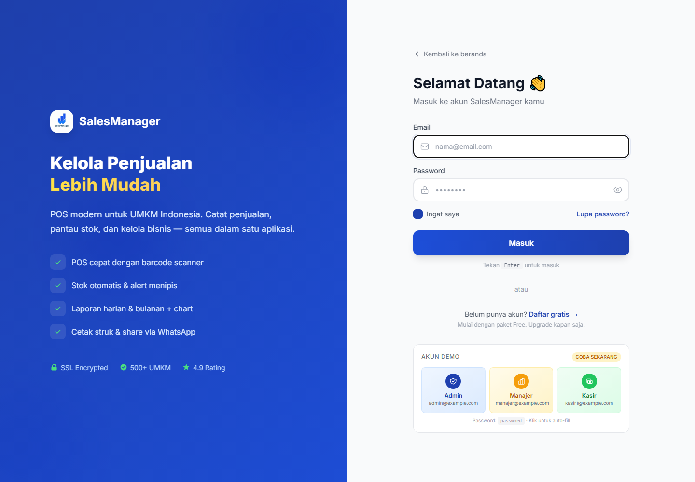
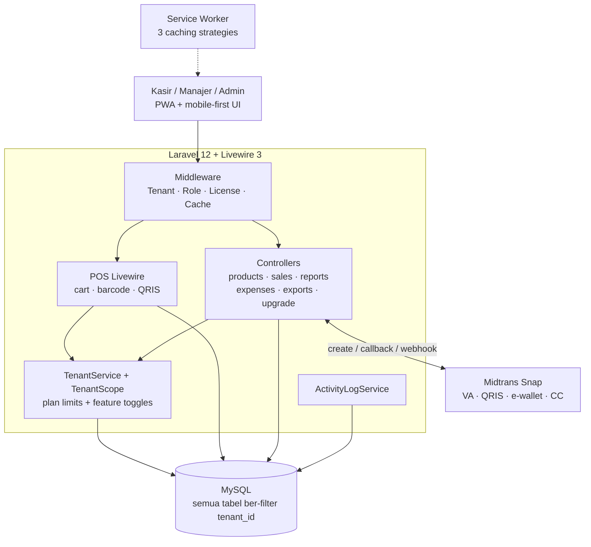

# SalesManager — POS & Manajemen Penjualan Multi-Tenant

**SaaS kasir untuk UMKM Indonesia: toko kelontong, retail, warung — dari Excel ke digital.**

---

## Tampilan

Halaman masuk — panel fitur di kiri, formulir + akun demo di kanan:

---

## Masalahnya

- Warung & retail kecil masih catat penjualan di **buku tulis** — rekap bulanan ribet, untung/rugi nggak kelihatan
- Software POS luar biasa mahal & overkill; yang lokal sering tidak multi-outlet dan tidak bisa offline
- Pemilik toko butuh **laporan + kontrol stok + struk** dari HP yang sama yang dipakai kasir

## SalesManager

Aplikasi **POS (Point of Sale) + manajemen penjualan** berbasis Laravel 12 + Livewire 3, arsitektur **multi-tenant dengan sistem berlangganan 3 tier** — satu deployment, banyak toko, data terisolasi rapi.

### Model Bisnis (built-in)

| Plan | Harga | Produk | Users | Pelanggan | Export | Reports | Expense |
|---|---|---|---|---|---|---|---|
| **Free** | Gratis | 50 | 1 | 25 | ❌ | ❌ | ❌ |
| **Basic** | Rp 27K/bln | 500 | 3 | 200 | ✅ Excel | ✅ | ✅ |
| **Pro** | Rp 75K/bln | ∞ | ∞ | ∞ | ✅ Excel+PDF | ✅ | ✅ |

Pembayaran via **Midtrans Snap** (VA, QRIS, e-wallet, kartu kredit) + webhook server-to-server. Trial 7 hari. Lisensi domain-bound untuk deployment self-hosted.

### Fitur

- **POS kilat** — pencarian produk, **scan barcode** (USB plug & play), diskon, quick-amount (Uang Pas…500K), kembalian otomatis, **QRIS modal**
- **Stok pintar** — threshold per produk, badge "Menipis/Habis", alert pasca-transaksi + tombol **notif WhatsApp ke supplier** (pesan pre-filled)
- **Struk** — kustomisasi header/footer + live preview, auto-print thermal 80mm, **share ke WhatsApp** pelanggan
- **Laporan** — harian & bulanan (Chart.js): revenue, transaksi, top produk, top kasir, **untung/rugi + breakdown pengeluaran**, perbandingan vs periode lalu
- **Multi-tenant** — TenantScope auto-filter semua query, plan limit di-enforce di controller, usage bar di dashboard
- **Feature toggle** — 9 fitur bisa dimatikan per toko (barcode, QRIS, diskon, notifikasi WA, dll) langsung dari settings
- **Role** — admin / manajer / kasir + activity log lengkap (login, CRUD, IP, user agent)
- **PWA offline-first** — service worker 3 strategi caching, installable, offline fallback, shortcut POS
- **Anti-logout** — session database 30 hari + auto-extend + regenerasi ID anti-fixation

---

## Arsitektur

- **Stack:** Laravel 12 (PHP 8.2+) · Livewire 3 · Tailwind · MySQL · Chart.js · Maatwebsite Excel + DomPDF · Midtrans SDK · QR-code
- **Kualitas:** audit internal 2026-08-31 — 40+ views lolos E2E (semua 200), CSRF penuh, 0 route/syntax error, transaksi POS atomic (`DB::transaction`)

---

## English

**SalesManager** is a point-of-sale and sales-management SaaS for small Indonesian retailers — grocery stores, shops, and warungs moving from notebooks and spreadsheets to a real system.

It runs on Laravel 12 and Livewire 3 with a multi-tenant architecture: one deployment serves many stores with isolated data, three subscription tiers, and Midtrans payments (virtual accounts, QRIS, e-wallets, cards) confirmed through server-to-server webhooks.

The source code is not published; this repository documents the product.

---

## Tentang Source Code

Repository ini adalah **showcase** — dokumentasi produk, bukan kode sumber.
Source code SalesManager tidak dipublikasikan dan semua hak dilindungi. Lihat [`LICENSE`](LICENSE).

> Demo, kolaborasi, atau lisensi? Hubungi [Kandar Lubis](https://github.com/kandarlubis31).

---

© 2026 Kandar Lubis — All Rights Reserved.
